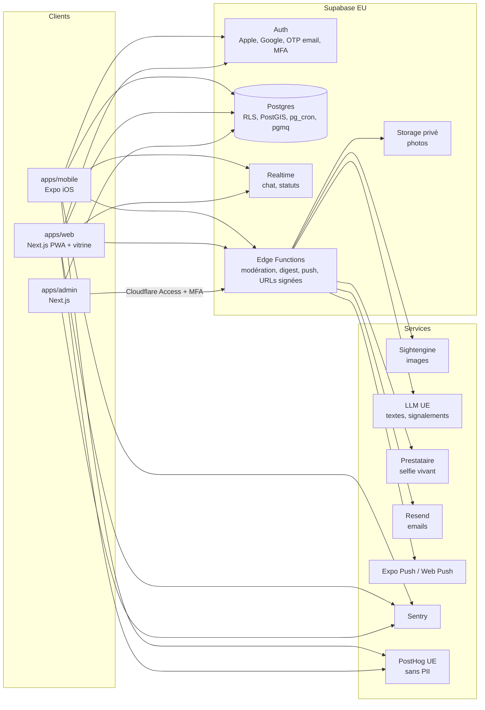

# 01 — Architecture et socle infra

## Vue d'ensemble



## Choix et raisons

| Couche | Choix | Pourquoi |
|---|---|---|
| Base | **Supabase, région UE (Paris `eu-west-3` de préférence, sinon Francfort)** | RLS pour les règles de visibilité, Auth, Realtime, Storage privé, PostGIS, pg_cron, files pgmq : tout au même endroit, en UE |
| Accès aux données | **supabase-js + RPC SQL, pas Prisma** | Prisma se connecte avec un rôle qui contourne la RLS : dangereux pour des données sensibles. Les types TypeScript sont générés par `supabase gen types` |
| Migrations | Supabase CLI (`supabase/migrations/*.sql`) | SQL versionné, testé, rejouable |
| Monorepo | pnpm + Turborepo | Code partagé entre mobile, web et admin |
| Mobile | Expo (SDK stable courant), expo-router, EAS Build et Submit | Build iOS depuis le Mac, Android plus tard sans réécriture |
| Web et admin | Next.js (App Router, version stable courante), `@supabase/ssr` | Déployés sur Vercel, projets séparés |
| Tâches de fond | Edge Functions + webhooks de base (pg_net) + pg_cron + pgmq | Modération instantanée, digest, expirations, ouverture des villes |
| Images | Sightengine (société française) | Nudité, lingerie, mineur apparent, texte dans l'image ; contrat UE |
| Textes | LLM hébergé en UE, derrière un adaptateur (défaut : Mistral) | Données sensibles : traitement en UE. Changement de fournisseur = un fichier |
| Vérification selfie | Adaptateur `VerificationProvider` (candidats : Veriff, Ubble, Onfido) | Choix contractuel de Justin. Fournisseur `mock` en local et staging |
| Emails | Resend (région UE) | Transactionnels uniquement |
| Push | Expo Push (iOS), Web Push VAPID (PWA) | Natif Expo |
| Erreurs | Sentry, `sendDefaultPii: false`, filtrage des données | Aucune donnée personnelle dans les rapports |
| Audience | PostHog Cloud UE, sans autocapture, sans enregistrement de session, identifiants hachés | Mesure d'usage sans traceur publicitaire |
| Accès admin | Cloudflare Access devant `admin.[DOMAINE]` + MFA Supabase obligatoire | Double barrière |
| Paiement | Stub au MVP (`entitlements` en base). V2 : RevenueCat (IAP Apple) + Stripe web | Paywall « Gratuit pour l'instant » d'abord |

## Arborescence cible

```
swapp/
├── AGENTS.md
├── .cursor/rules/            règles Cursor
├── .claude/agents/           sous-agents
├── apps/
│   ├── mobile/               Expo
│   ├── web/                  Next.js PWA + vitrine
│   └── admin/                Next.js console
├── packages/
│   ├── core/                 logique métier pure TS (classement, compatibilité, grades, banque « Pas pour nous », règles de visibilité côté client)
│   ├── supabase/             types générés, clients, wrappers RPC typés
│   ├── ui-tokens/            couleurs, typo, espacements (depuis DESIGN.md)
│   ├── ui-native/            composants React Native (DESIGN.md)
│   ├── ui-web/               composants web (DESIGN.md)
│   ├── i18n/                 textes FR (tu/vous, je/nous)
│   └── config/               tsconfig, eslint, vitest partagés
├── supabase/
│   ├── migrations/
│   ├── functions/            Edge Functions (Deno)
│   ├── tests/                pgTAP (RLS, RPC)
│   └── seed.sql              données de test locales uniquement (is_test = true)
├── e2e/
│   ├── web/                  Playwright (web + admin)
│   └── mobile/               Maestro (iOS simulateur)
└── docs/
```

## Environnements

| Env | Supabase | Web / admin | Mobile | Données |
|---|---|---|---|---|
| local | `supabase start` (Docker) | `pnpm dev` | Expo Go / dev client | `seed.sql`, comptes de test |
| staging | Projet `swapp-staging` (UE, offre gratuite) | Vercel Preview | EAS profil `preview`, TestFlight interne | Comptes de test marqués `is_test` |
| production | Projet `swapp-prod` (UE, **offre Pro**, sauvegardes PITR) | Vercel Production | EAS profil `production`, App Store | Réelles uniquement |

Règle : aucun agent n'exécute d'action en production (migration, déploiement, soumission). Il prépare, le superviseur consigne, Justin exécute (voir `AGENTS.md`, points d'arrêt).

## Domaines (à remplacer quand le nom de domaine est acquis)

| Usage | Domaine |
|---|---|
| Site vitrine + PWA | `[DOMAINE]`, `app.[DOMAINE]` |
| Console | `admin.[DOMAINE]` (Cloudflare Access) |
| Emails | `notifications@[DOMAINE]` (SPF, DKIM, DMARC) |

## Variables d'environnement

Voir `.env.example`. Règles :
- `SUPABASE_SERVICE_ROLE_KEY` n'existe que dans les Edge Functions et le serveur de l'admin. Jamais dans `apps/mobile`, jamais préfixée `NEXT_PUBLIC_` ou `EXPO_PUBLIC_`.
- Les clés des prestataires (Sightengine, LLM, vérification, Resend) n'existent que dans les secrets des Edge Functions.
- Contrôle automatique : `gitleaks` en CI, et un test qui échoue si une variable publique contient `service_role`, `secret` ou `key` hors liste blanche.

## Budget de fonctionnement indicatif (avant utilisateurs payants)

| Poste | Coût mensuel |
|---|---|
| Supabase Pro (prod) | ~25 $ (+ calcul selon usage) |
| Vercel | Hobby au départ, Pro (20 $) si besoin commercial |
| Apple Developer | 99 $/an |
| Sightengine | selon volume (offre de départ ~29 $) |
| Vérification selfie | 0,5 à 1,5 € par vérification selon prestataire |
| LLM | quelques euros au lancement |
| Sentry, PostHog, Resend, Cloudflare Access | offres gratuites au lancement |

## Performances

- Ouverture de l'appli < 2 s sur iPhone récent.
- Découvrir : première page < 400 ms côté serveur (index GiST PostGIS + index composites, voir `02-base-de-donnees.md`).
- Images : compressées sur le téléphone (WebP, 1600 px max), vignettes générées par la transformation d'images Supabase, préchargement des 2 pages suivantes.
- Budget JS web : < 200 Ko gzip sur la route Découvrir.
