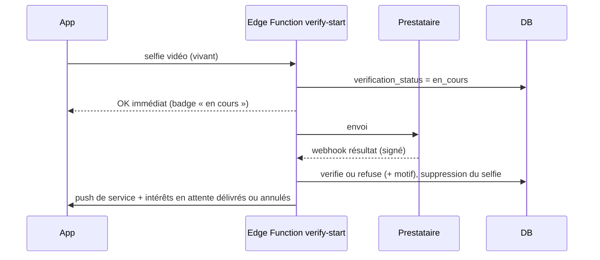

# 03 — Authentification et sessions

Tout repose sur **Supabase Auth**, dans le même projet que les données, pour que la RLS connaisse l'utilisateur (`auth.uid()`).

## Membres (appli iOS et PWA)

| Méthode | Mobile (Expo) | Web (Next.js) |
|---|---|---|
| **Apple** (obligatoire dès qu'on propose Google, règle 4.8) | `expo-apple-authentication` → `supabase.auth.signInWithIdToken({ provider: 'apple', token, nonce })` (nonce haché SHA-256) | OAuth Apple via Supabase (`signInWithOAuth`) |
| **Google** | `@react-native-google-signin/google-signin` → `signInWithIdToken({ provider: 'google' })` | OAuth Google via Supabase |
| **Email** | Code à usage unique à 6 chiffres (`signInWithOtp` + `verifyOtp` type `email`). Pas de lien magique : les liens profonds sont fragiles et les messageries les ouvrent dans leur navigateur | Même code à 6 chiffres |

Pas de mot de passe au MVP : moins de support, pas de fuite de mots de passe.

### Règles

- **Âge** : la date de naissance est demandée à l'inscription ; < 18 ans = refus immédiat, sans création de profil. Le selfie de vérification et, en option, la pièce d'identité confirment ensuite.
- **Un compte = un membre** (`members.id = auth.users.id`). Un couple = deux comptes liés par `profile_members`.
- **Sessions mobile** : stockées dans `expo-secure-store` (Keychain), jamais dans AsyncStorage en clair. Rafraîchissement automatique.
- **Sessions web** : `@supabase/ssr`, cookies `HttpOnly`, `Secure`, `SameSite=Lax`. Middleware Next.js qui rafraîchit la session.
- **Verrou de l'appli** : code PIN et Face ID via `expo-local-authentication`, demandés à chaque retour au premier plan si activés. Vignette floutée dans le sélecteur d'applis (écran neutre posé sur l'événement `AppState` inactif).
- **Double authentification membre** (facultative) : MFA TOTP de Supabase (`mfa.enroll`, `mfa.challenge`).
- **Déconnexion de tous les appareils** : `signOut({ scope: 'global' })` + suppression des `push_tokens`.
- **Suppression du compte** depuis l'appli (Apple 5.1.1(v)) : RPC `delete_account` → profil masqué immédiatement, Edge Function qui révoque le jeton Apple (Apple l'exige pour Sign in with Apple), supprime l'utilisateur Auth et planifie l'effacement des photos sous 30 jours. Les données d'identification légales sont gardées 1 an dans une table chiffrée à part.
- **Emails Auth** : modèles en français, envoyés via SMTP Resend, texte neutre (« Ton code de connexion : 123456 »), sans mot libertin dans l'objet.
- **Anti-robots** : limitation de débit Supabase Auth, CAPTCHA (hCaptcha ou Turnstile) sur le web, App Attest sur iOS en phase de durcissement, plafond de comptes par appareil (`devices`).

### Inscription (3 écrans maximum avant l'appli)

1. Connexion (Apple, Google, email) → type de profil, date(s) de naissance, ville.
2. « Qui peut te voir ? » (4 niveaux, Flouté présélectionné).
3. Selfie de vérification : envoi en un geste, statut « Vérification en cours » immédiat, l'utilisateur continue.

Le reste (photos, envies, présentation) se complète ensuite, guidé depuis Profil.

### Vérification (asynchrone)

Le webhook du prestataire est vérifié par signature HMAC. Le selfie est supprimé dès la décision ; seul le résultat est gardé.

## Administrateurs (console)

| Barrière | Mise en œuvre |
|---|---|
| Réseau | `admin.[DOMAINE]` derrière **Cloudflare Access** (email de Justin autorisé, code par email ou clé d'accès) |
| Compte | Compte Supabase Auth dédié, email distinct de tout compte membre, ligne dans `admin.admin_users`. Aucune inscription publique : création uniquement par script avec la clé service |
| MFA | TOTP obligatoire. Toute route et toute RPC admin vérifie `auth.jwt() ->> 'aal' = 'aal2'` et le rôle |
| Rôle dans le jeton | Custom Access Token Hook Supabase qui ajoute `app_role` au JWT depuis `admin.admin_users` |
| Session | Expiration après 15 min d'inactivité côté serveur admin |
| Clé service | Utilisée uniquement dans les Route Handlers et Server Actions de l'admin, jamais envoyée au navigateur |
| Traçabilité | Chaque lecture de fiche et chaque action écrit dans `admin.audit_log` (append-only) |
| Contenu sensible | Photos privées floutées jusqu'au clic « Afficher pour modérer », journalisé |

## Tests obligatoires

- E2E : inscription email (code récupéré via Inbucket/Mailpit local), refus < 18 ans, Apple et Google en mode test (mock du jeton d'identité en local).
- pgTAP : une RPC admin appelée avec un jeton aal1 échoue ; un membre avec `app_role` absent échoue ; un admin ne peut pas créer de profil.
- Vérification : webhook à signature invalide rejeté ; selfie supprimé après décision.
