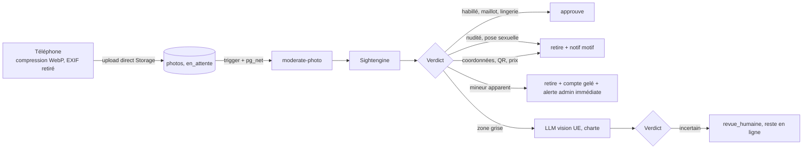

# 04 — Modération automatique et tâches de fond

Objectif : moins de 15 minutes de modération humaine par jour. L'IA décide seule, sauf mineur suspecté et appels.

## Pipeline photo



- **Photos de profil et d'album** : visibles immédiatement (le flou par défaut limite l'exposition), retirées en quelques secondes si besoin.
- **Photos en message** : l'expéditeur voit « envoyé » tout de suite ; le destinataire ne reçoit le message qu'après `approuve` (statut `en_moderation` → `livre`). Seule exception à la publication immédiate.
- **Contrôles en plus** : au moins une photo publique doit correspondre au visage du selfie (comparaison fournie par le prestataire de vérification) ; empreinte perceptuelle (`phash`) comparée aux photos refusées et aux autres comptes.
- **Reprise** : une tâche planifiée relance les photos restées `en_attente` plus de 2 minutes (panne d'un service).
- **Seuils** : dans `admin.settings`, réglables depuis la console.

## Pipeline texte

| Contenu | Contrôle |
|---|---|
| Profil (accroche, présentation, prompts) | LLM à l'enregistrement : offre tarifée, coordonnées, insultes, mention de mineurs, menaces |
| Premier message d'une conversation | LLM |
| Messages suivants | Règles seulement (expressions régulières : téléphone, email, réseaux, liens, tarifs, « WhatsApp », « Telegram ») ; contenu complet analysé seulement si la conversation est signalée |
| Envoi en masse | Empreinte du texte : même message à > 5 profils en 1 h = ralentissement + avertissement |

## Signalements et sanctions

L'Edge Function `triage-case` lit le contenu signalé, produit un résumé, une gravité et une action avec un niveau de confiance, et applique :

| Cas | Action automatique |
|---|---|
| Profil vénal certain (tarif + coordonnées) | Bannissement immédiat, appel possible |
| 3 photos refusées pour nudité | Suspension 7 jours |
| Insultes ou harcèlement confirmés | Avertissement → suspension 7 j → bannissement |
| 3 signalements de membres différents | Masquage immédiat, puis décision IA |
| Note ≤ 2 en « Respect et consentement » | Analyse de la conversation, avertissement ou suspension |
| Bannissement proposé (hors cas certain) | `effective_at = now() + 24 h`, annulable dans la console |
| Mineur suspecté | Gel + alerte immédiate (email + push admin). **Décision humaine obligatoire** |

Chaque sanction : motif communiqué au membre, mention « décision automatique » (DSA), lien d'appel (15 jours). Les appels arrivent dans la console (RGPD art. 22).

**Une seule alerte admin par jour** (récapitulatif), sauf mineur suspecté. Chaque lundi : 20 décisions tirées au hasard pour contrôle qualité.

## Adaptateurs (pour changer de fournisseur sans toucher au reste)

```ts
// packages/core/src/providers.ts (interfaces), implémentations dans supabase/functions/_shared/
interface ImageModerator { analyze(url: string): Promise<ImageVerdict> }
interface TextModerator { analyze(input: TextInput): Promise<TextVerdict> }
interface VerificationProvider { start(session): Promise<{ref}>; parseWebhook(req): Promise<VerificationResult> }
```

Chaque adaptateur a une implémentation `mock` déterministe utilisée en local, en CI et en staging tant que Justin n'a pas fourni les clés.

## Notifications et digest

- Push uniquement pour : nouveau message, intérêt accepté, rappel d'une soirée où l'on est inscrit, messages de service (vérification, photo retirée, sanction, ouverture de la ville).
- Texte neutre par défaut : « Nouveau message ». Aucun pseudo, aucun mot libertin sur l'écran verrouillé.
- Plafond : 5 push par jour ; au-delà, l'événement part dans `digest_items`.
- Digest à l'heure choisie (défaut 19 h) : clins d'œil reçus, nouveaux profils des Radars, intérêts expirés (formulation bienveillante), « 4 personnes attendent ta réponse », coach de profil hebdomadaire, repères réalistes.

## Coach de profil (hebdomadaire, dans le digest)

Règles calculées dans `packages/core` (testées) : photos toujours floues après intérêt mutuel, texte < 30 mots, filtres qui excluent > 80 % des profils proches, messages d'intro identiques, taux de réponse comparé à la moyenne de son type. Ton bienveillant, jamais de compteur humiliant.

## Banque « Pas pour nous »

- 40 modèles au lancement (10 par combinaison je/nous × tu/vous), dans `refusal_templates`, éditables dans la console.
- Sélection (`packages/core`) : combinaison de formes ; raison réelle si le profil est hors critères (type, distance, âge) avec les vraies valeurs ; jamais deux fois le même texte au même destinataire.
- Envoi différé aléatoire entre 1 h et 6 h. Personnalisable avant envoi, 3 messages perso enregistrables.
