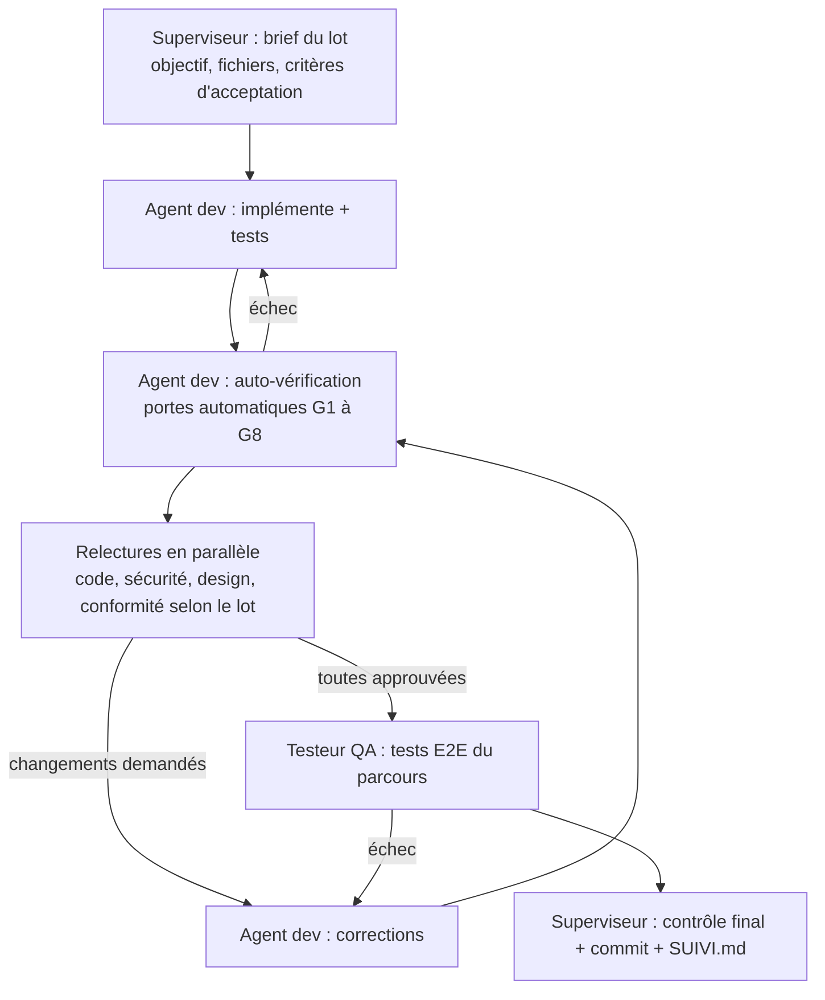

# 05 — Processus qualité : relecture et contrôle du code

Rien n'est « fait » sans être passé par toutes les étapes ci-dessous. Le superviseur refuse un lot incomplet.

## Le cycle d'un lot



Limite : 3 allers-retours de relecture maximum sur un même lot. Au-delà, le superviseur découpe le lot ou change d'approche et l'écrit dans `DECISIONS.md`.

## Portes automatiques (à lancer par l'agent dev avant toute relecture)

**Par lot**, seulement sur ce qui a changé : `pnpm turbo run lint typecheck test build --filter=...[HEAD]` ; G4 et G5 seulement si `supabase/` a changé ; G8 seulement si un écran web a changé. **En fin de phase**, toutes les portes sur tout le dépôt. Sorties réduites aux erreurs (`docs/07-economie-de-contexte.md`).

| Porte | Commande | Seuil |
|---|---|---|
| G1 Format et lint | `pnpm lint` | 0 erreur, 0 avertissement nouveau |
| G2 Types | `pnpm typecheck` | 0 erreur, `strict: true`, aucun `any` nouveau sans commentaire justifié |
| G3 Tests unitaires | `pnpm test` | Tout vert ; couverture ≥ 90 % sur `packages/core`, ≥ 70 % ailleurs sur le code modifié |
| G4 Base de données | `supabase db reset && supabase test db` | Migrations rejouables depuis zéro, tous les tests pgTAP verts, `supabase db lint` sans erreur |
| G5 Types générés | `pnpm db:types && git diff --exit-code packages/supabase/src/types.ts` | Types à jour |
| G6 Build | `pnpm build` | Les 3 applis compilent |
| G7 Sécurité | `pnpm audit --prod`, `gitleaks detect` | Aucune vulnérabilité haute ou critique, aucun secret |
| G8 Accessibilité web | `pnpm e2e:a11y` (axe via Playwright) | 0 violation sérieuse ou critique sur les écrans touchés |

## Relectures

Chaque relecteur est un sous-agent **en lecture seule** qui n'a pas écrit le code. Il reçoit le diff du lot (pas le dépôt entier) et rend un verdict structuré, limité aux problèmes :

```
VERDICT: APPROUVE | CHANGEMENTS_DEMANDES
BLOQUANTS:
- [fichier:ligne] problème → correction attendue
NON_BLOQUANTS:
- ...
```

| Relecteur | Obligatoire quand le lot touche | Ce qu'il vérifie |
|---|---|---|
| `relecteur-code` | Toujours | Lisibilité, découpage, nommage, duplication, gestion d'erreurs, UI optimiste correcte (rollback), tests qui testent vraiment le comportement, respect de l'arborescence |
| `relecteur-securite` | `supabase/`, auth, stockage, RPC, admin, Edge Functions, données personnelles | RLS, matrice de visibilité, `SECURITY DEFINER` avec `search_path` fixé, aucune clé service côté client, validation des entrées (zod), limitation de débit, injection, webhooks signés, données dans les logs |
| `relecteur-design` | Tout écran | Conformité à `docs/design/DESIGN.md` (tokens, typo, composants, bandes 70s), une action par écran, textes FR (tutoiement, ton), états vides, accessibilité (VoiceOver, contrastes, tailles) |
| `relecteur-conformite` | Contenus, photos, messages, notation, paiement, données, notifications | `docs/06-conformite.md`, non-négociables de `00-vision.md` |

## Tests E2E (testeur QA)

- **Web et admin** : Playwright, parcours complets sur Supabase local.
- **Mobile** : Maestro sur simulateur iOS. Les agents qui tournent sur le Mac de Justin peuvent lancer le simulateur ; les agents cloud lancent seulement les tests unitaires et web, et le superviseur note les parcours mobiles à rejouer en local.
- Par lot : seulement le parcours touché (web). En fin de phase : tous les parcours, web et mobile (non-régression).

## Définition de « terminé » (lot)

- [ ] Critères d'acceptation du lot tous vérifiés, avec la preuve (commande, test ou capture) dans le rapport du lot
- [ ] Portes G1 à G8 vertes
- [ ] Relectures obligatoires approuvées
- [ ] E2E du parcours vert
- [ ] Documentation mise à jour si le comportement change (`docs/`)
- [ ] Commit sur la branche de phase, message `type(portée): description [P3-04]`
- [ ] `docs/SUIVI.md` mis à jour

## Fin de phase

1. Le superviseur lance une **relecture globale** de la phase par les 4 relecteurs (vision d'ensemble, pas seulement lot par lot).
2. Il rejoue toutes les portes et tous les E2E.
3. Il écrit `docs/rapports/phase-N.md` : ce qui est livré, preuves, écarts, dette technique, décisions prises, actions attendues de Justin.
4. Il s'arrête. Justin relit, fusionne et crée la branche de la phase suivante.

## CI (GitHub Actions)

`.github/workflows/ci.yml` rejoue G1 à G7 et les E2E web à chaque push. Une CI rouge bloque la fin de phase.
